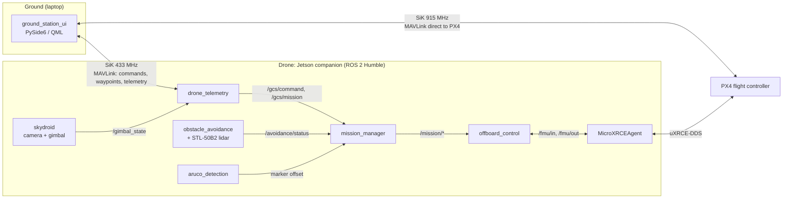

# EIU-FABLAB-UAV-AUTONOMY

Autonomous quadrotor built on PX4 and ROS 2 Humble. A Jetson companion computer flies waypoint missions in OFFBOARD mode, avoids obstacles with a 2D lidar and picks up loads at waypoints using an ArUco marker. The operator plans and monitors the flight from a desktop ground station over two radios.

> Developed by the EIU FabLab team for autonomous UAV research and education.

## Authors

| Name | Role |
|---|---|
| Tran Duy Nhat | Project lead, UAV autonomy, ROS 2 integration |
| Vo Pham Mai Uyen | Control logic, vision and camera system |
| Vo Hoang Yen Nhi | Control logic, vision and camera system |

## System overview



The ground station has two links. The 433 MHz radio goes to the Jetson: Take-off, Land, Start mission, waypoint upload and companion telemetry (component health, pose, mission progress) pass through `drone_telemetry`. The 915 MHz radio goes straight to PX4 for standard MAVLink telemetry and a fallback Take-off / Land when the Jetson is down.

On the Jetson the work is split so that each node has one job:

- `drone_telemetry` is the only node on the 433 radio. It checks and routes commands, and forwards telemetry.
- `mission_manager` decides what to fly: the flight state machine and the mission pipeline (navigate, pick tasks, pilot hand-over).
- `offboard_control` is the only node that commands PX4: setpoint stream, OFFBOARD, ARM, LAND.
- `obstacle_avoidance` and `aruco_detection` only provide data. They never command PX4.

The drone never takes off on its own. Every flight starts with a command from the ground station, and the RC pilot can take over at any time by moving the sticks, which pauses the mission.

## Packages

| Package | Runs on | Language | Role |
|---|---|---|---|
| [`ground_station_ui`](ground_station_ui/README.md) | laptop | Python, PySide6/QML | Ground station: map with offline tiles, waypoint planning with tasks, 3D view, flight commands, telemetry and diagnostics |
| [`drone_telemetry`](drone_telemetry/README.md) | Jetson | Python | MAVLink bridge on the 433 radio: component health, pose, position, gimbal and mission progress down; commands and waypoints up |
| [`offboard_control`](offboard_control/README.md) | Jetson | Python | `mission_manager` (state machine, mission pipeline, pick tasks, live speed and tolerance) and `offboard_control` (PX4 interface over uXRCE-DDS) |
| [`obstacle_avoidance`](obstacle_avoidance/README.md) | Jetson | Python, C++ | VFH+ avoidance from a 360° 2D lidar with a stopping-distance speed limit; STL-50B2 lidar driver |
| [`aruco_detection`](aruco_detection/README.md) | Jetson | Python | ArUco detection and marker position relative to the drone, for pick tasks and precision landing |
| `skydroid` | Jetson | C++, Python | Skydroid payload: RGB and thermal camera (`/skydroid/*/image_raw`), gimbal control (`/gimbal_state`) |
| `skydroid_msgs` | Jetson | msg | `GimbalAttitude`, `GimbalCommand`, `GimbalState` |
| [`realsense_d435i`](realsense_d435i/docs/README.md) | Jetson | C++ | Lightweight RealSense D435i driver (stereo IR + IMU) for visual-inertial odometry indoors |
| `vio_bridge` | Jetson | C++ | Forwards OpenVINS odometry to the autopilot, rejecting jumps and divergence |
| `custom_msgs` | Jetson | msg / srv | Project messages, including `AvoidanceStatus` |
| `script`, `docker` | — | shell | Docker images and launch scripts for the Jetson and the development PC |

Each package with a link has its own README (usage) and, for the main ones, a `docs/ARCHITECTURE.md`.

## Flight flow

1. **Plan.** On the ground station, add waypoints on the map, give each one a task if needed (fly through, or pick with automatic or manual hook), set the mission speed and arrival tolerances, then **Send WP**.
2. **Take-off.** The drone climbs vertically at its current position and hovers.
3. **Start mission.** Optionally with ☑ Obstacle avoidance. The drone turns towards each waypoint, flies to it at the mission speed and runs its task. Speed and tolerances can be changed during the flight.
4. **Pick task.** Descend to the search height, find the marker, align over it, hook the load (automatically, or the pilot takes over and presses Continue), climb back.
5. **Land** at any time; the mission is aborted and the drone lands in place.

Details: [offboard_control/docs/MISSION_PIPELINE.md](offboard_control/docs/MISSION_PIPELINE.md).

## Build

```bash
conda deactivate                         # colcon needs the system Python
cd ~/drone_ws
colcon build --packages-select custom_msgs px4_msgs drone_telemetry offboard_control obstacle_avoidance aruco_detection
source install/setup.bash
```

`px4_msgs` must match the PX4 firmware version. On the Jetson the stack runs in Docker (see `docker/README.md`); the ground station runs on the laptop with `ground_station_ui`.

## Run

On the Jetson:

```bash
MicroXRCEAgent serial --dev /dev/ttyTHS1 -b 921600          # PX4 <-> ROS 2 (adjust port and baud)
ros2 launch drone_telemetry telemetry.launch.py              # 433 radio link
ros2 launch offboard_control px4_offboard.launch.py          # mission_manager + offboard_control
ros2 launch obstacle_avoidance stl_50b2.launch.py            # lidar (if avoidance is used)
ros2 launch obstacle_avoidance avoidance_launch.py
```

On the laptop: start `ground_station_ui` (see its README), connect the 433 and 915 radios in the Links tab.

## Safety

- Every flight starts from an explicit command at the drone's current position.
- The RC transmitter always has priority: moving the sticks pauses the mission, the kill switch ends the flight.
- If the Jetson stops streaming setpoints, PX4 leaves OFFBOARD and applies its failsafe.
- Obstacle avoidance is refused until `allow_avoidance` is enabled after testing; pick tasks fly close to the ground. Test new features in SITL first, then with the propellers removed.
