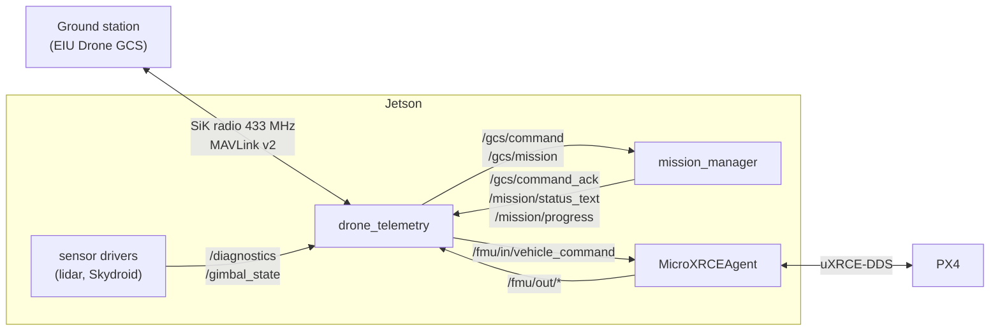
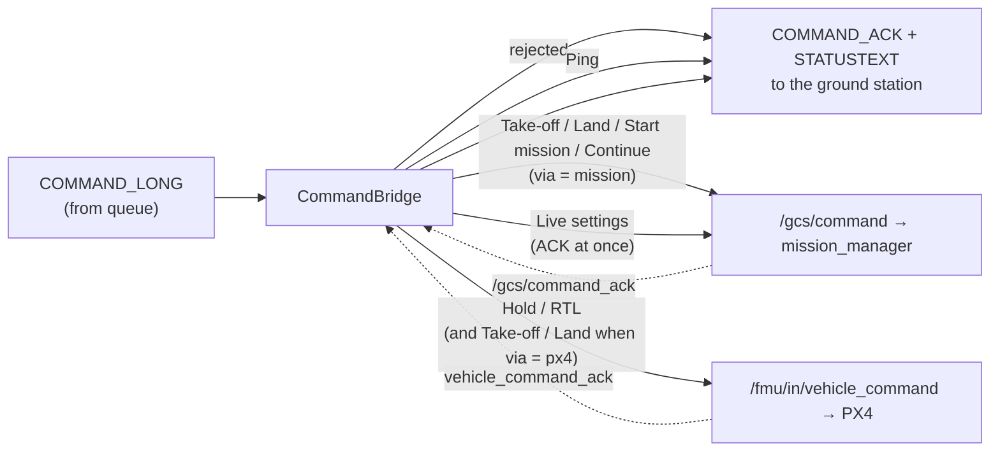

# drone_telemetry — Architecture

This document describes how `drone_telemetry` is built: its place between the ground station, the Jetson nodes and PX4, its internal threads and modules, and how telemetry and commands flow through it. Usage and configuration are in the [README](../README.md).

## 1. Place in the system



`drone_telemetry` is the only Jetson node on the 433 radio. Everything the ground station knows about the Jetson side comes through it, and every command from the ground station enters the Jetson through it. It does not fly the drone: Take-off, Land and missions are executed by `mission_manager` and `offboard_control` (package `offboard_control`).

## 2. Modules

| Module | Role | Depends on ROS |
|---|---|---|
| `telemetry_node.py` | ROS node: parameters, subscriptions, timers, wiring between the modules | yes |
| `radio_link.py` | `RadioLink`: serial port, MAVLink encode / write, read thread with parser, reopen after errors | no |
| `health.py` | `ComponentMonitor`: level, state and rate of one component | no |
| `commands.py` | `CommandBridge`: command rules and routing; `MissionReceiver`: waypoint upload | no |
| `drone_dialect.py` | MAVLink dialect generated from `mavlink/drone_telemetry.xml` | no |

Only `telemetry_node.py` imports `rclpy`. The other modules take callbacks and a logger, which keeps them testable without ROS or hardware (`test/`).

## 3. Threads

```
serial thread (RadioLink)                     ROS executor thread (TelemetryNode)
─────────────────────────                     ────────────────────────────────────
read -> parse MAVLink                         subscriptions: /diagnostics, /fmu/out/*, /gimbal_state,
  RADIO_STATUS          -> kept (latest)                     /gcs/command_ack, /mission/*
  COMMAND_LONG,                               timers:
  MISSION_COUNT,        -> queue ──────────►    50 ms   process queued commands (CommandBridge, MissionReceiver)
  MISSION_ITEM_INT                              200 ms  component tick: rates, STALE, send changes
                                                send_rate_hz        DRONE_COMPONENT_STATUS (all components)
writes come from the ROS thread               heartbeat_rate_hz   HEARTBEAT
through RadioLink.send() (locked)               pose.rate_hz        DRONE_LOCAL_POSE
                                                global_position     GLOBAL_POSITION_INT
                                                gimbal_state        DRONE_GIMBAL_STATE
                                                1 s     own diagnostics on /diagnostics
                                                1 s     MISSION_CURRENT (mission route)
```

The serial thread never touches ROS objects; it only stores the latest `RADIO_STATUS` and puts command packets on a `queue.Queue`. All decisions and publications happen on the ROS thread. Writes to the port are serialised inside `RadioLink`.

If the port is missing or unplugged, `RadioLink` marks it closed instead of raising; the heartbeat timer calls `ensure_open()` every second, so the link comes back on its own when the radio is plugged in again. The launch file also restarts the node if it exits (`respawn`).

## 4. Telemetry path

### Component health

Each component in `config/telemetry.yaml` gets a `ComponentMonitor` fed by one source:

| Source | Input | Rate |
|---|---|---|
| `diagnostics` | `DiagnosticStatus` on `/diagnostics` matched by `diag_name` | read from `values[rate_key]`, or derived from the counter `values[count_key]` |
| `topic` | every message on a topic (PX4, which publishes no diagnostics) | counted by the node over `rate_window`; below `min_rate_hz` → WARN |

A monitor without data for `stale_timeout_s` reports `STALE`. Status is sent for all components every `1 / send_rate_hz`, and immediately when a component's level or state changes, so a failure appears on the ground station without waiting for the next period. A diagnostics counter that goes down (driver restarted) is ignored for one sample instead of producing a negative rate.

The radio is reported as an extra component (`DRONE_COMPONENT_RADIO`): the state is the free transmit buffer from `RADIO_STATUS` (`BUF xx%`), the rate is the downlink in bytes per second. Below 50 % free the level is WARN, below 30 % ERROR.

### Pose, position and gimbal

| Stream | Input | Message | Rate |
|---|---|---|---|
| Pose | `/fmu/out/vehicle_odometry` | `DRONE_LOCAL_POSE` (NED, quaternion, velocity, reset counter) | 5 Hz |
| Global position | `/fmu/out/vehicle_global_position` + odometry | standard `GLOBAL_POSITION_INT` (relative altitude, velocity and heading from odometry) | 2 Hz |
| Gimbal | `/gimbal_state` | `DRONE_GIMBAL_STATE` | 2 Hz |

Each stream keeps only the latest sample and sends it from its own timer. A sample older than the stream's `max_age_s` is not sent, so the ground station sees the data go stale instead of a frozen value. Position is sent only while PX4 reports `lat_lon_valid`.

The pose stays in PX4 conventions (NED, FRD body); the ground station converts it to ENU / FLU for display. `GLOBAL_POSITION_INT` lets the ground station draw the drone on the map when its direct 915 MHz link to PX4 is missing.

### Bandwidth

The 433 radio carries about 2 KB/s. With the default rates the downlink uses roughly 300 B/s for pose, 80 B/s for position, 60 B/s for the gimbal, plus component status and heartbeats. The radio component's buffer level shows when the link is close to saturation; lowering `pose.rate_hz` is the main lever.

## 5. Command path



### Rules

`CommandBridge.handle()` checks every command before anything is sent:

| Condition | Result |
|---|---|
| no PX4 data within `PX4_FRESH_S` (2 s) | `TEMPORARILY_REJECTED` "no PX4 data (DDS agent?)" |
| Take-off while in the air | `DENIED` "already flying" |
| Land / Hold / RTL on the ground | `DENIED` "vehicle is on the ground" (Land during a take-off in progress is allowed and cancels it) |
| a different command arrives while one is running | the new command replaces the old one |
| the same command resent (`confirmation > 0`) | not executed again: `IN_PROGRESS` while running, the stored result if it finished within `RESULT_HOLD_S` |

The flight state comes from PX4: `vehicle_land_detected` (landed), `vehicle_control_mode` (armed) and `vehicle_global_position` (AMSL altitude). `vehicle_status` is not used because its message version differs between the firmware and the workspace `px4_msgs`.

### Acknowledgement

A command is answered in two stages. While waiting, the node resends `IN_PROGRESS` every 0.5 s so the ground station does not time out. The final result depends on the route:

- **mission route** (Take-off, Land, Start mission, Continue): `mission_manager` must accept the JSON command on `/gcs/command_ack` (one resend after 1 s), and then PX4 must acknowledge what `offboard_control` sends within `PX4_CONFIRM_TIMEOUT_S` (6 s): DO_SET_MODE OFFBOARD and ARM for Take-off, NAV_LAND for Land. Start mission, Continue and a Land before ARM need no PX4 acknowledgement. A Start mission with options may be answered only when the options are ready, so `mission_manager` keeps that check under 2 s (`avoidance_ready_timeout`).
- **direct route** (Hold, RTL, and Take-off / Land with `takeoff_land_via: px4`): the node sends one or more `VehicleCommand` steps (e.g. ARM, then NAV_TAKEOFF with the AMSL altitude) and waits for each `vehicle_command_ack`; a missing ACK is resent once after 3 s, then the command fails.

The result goes back as `COMMAND_ACK`, with a `STATUSTEXT` explaining a rejection or failure.

### Waypoint upload

`MissionReceiver` implements the receiving side of the MAVLink mission protocol:

```
ground                         drone_telemetry
 │ MISSION_COUNT(n) ──────────►│
 │◄────── MISSION_REQUEST_INT(0)│
 │ MISSION_ITEM_INT(0) ────────►│   missing item: request again after 1.5 s, up to 5 times
 │ ...                          │
 │◄────── MISSION_ACK(ACCEPTED) │──► /gcs/mission (JSON, transient-local)
```

If the final `MISSION_ACK` is lost, the ground station resends the last item and the node resends the ACK without restarting the upload. The JSON list is latched, so `mission_manager` gets it even if it starts later. Each item keeps its MAVLink command and `param1..4`, which carry the task at the waypoint (for example the pick task, see `offboard_control/docs/MISSION_PIPELINE.md`). Waypoints are only stored here; `mission_manager` flies them on Start mission.

### Mission commands and feedback

| Ground station | Jetson |
|---|---|
| `MISSION_START`, `param3` = option bitmask (bit 0 = obstacle avoidance), `param4` = speed (m/s), `param5` / `param6` = arrival tolerance xy / z (m); 0 = default | `{"cmd": "mission", "options": {"avoidance", "speed", "xy_tolerance", "z_tolerance"}}` on `/gcs/command` |
| `DO_PAUSE_CONTINUE`, `param1 = 1` | `{"cmd": "continue"}`; `param1 = 0` (pause) is refused as unsupported |
| `MAV_CMD_USER_2` (31011), `param1` speed, `param2` / `param3` tolerance xy / z, 0 = unchanged | `{"cmd": "settings", "options": {"speed", "xy_tolerance", "z_tolerance"}}`; not a job: ACCEPTED is sent at once, a running Take-off or Start mission keeps going, and `mission_manager` reports the result as `STATUSTEXT` |
| `MISSION_CURRENT` (seq, total, mission_state) | from `/mission/progress`, once per second and on every change; state `idle` / `active` / `paused` / `complete` maps to NOT_STARTED / ACTIVE / PAUSED / COMPLETE |
| `STATUSTEXT` | from `/mission/status_text`, e.g. the request to take control for a manual task |

## 6. MAVLink identity and dialect

The node uses system id 1 and component id 191 (`MAV_COMP_ID_ONBOARD_COMPUTER`), the same system id as the autopilot, so the ground station groups both under one vehicle and routes commands for component 191 to this node. Heartbeats are sent as MAVLink v1 because SiK 1.9 radios only inject `RADIO_STATUS` after seeing a v1 heartbeat; all other messages are MAVLink v2.

Custom messages use IDs 45000-45099 and are defined in `mavlink/drone_telemetry.xml`. `drone_dialect.py` is generated from it by `scripts/gen_dialect.sh` and must be identical on the Jetson and in the ground station (`ground_station_ui/core/mavlink/drone_dialect.py`).
