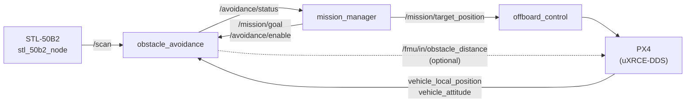

# obstacle_avoidance — Architecture

How the node is built: its interface with `mission_manager`, the modules, the VFH+ steps, the speed limit and the timing. Usage is in the [README](../README.md), the behaviour in each situation in [BEHAVIOR.md](BEHAVIOR.md).

## 1. Place in the system



The node only proposes. `mission_manager` reads the status, decides to follow the setpoint, hold or land, keeps the altitude of the mission, and is the only writer of the target. The optional `obstacle_distance` output feeds PX4 Collision Prevention and is independent of the mission.

## 2. Interface

| Topic | Type | Direction | Content |
|---|---|---|---|
| `/scan` | `sensor_msgs/LaserScan` | in | 360° scan |
| `/fmu/out/vehicle_local_position_v1` | `px4_msgs` | in | position, velocity, `dist_bottom` |
| `/fmu/out/vehicle_attitude` | `px4_msgs` | in | quaternion, to rotate the scan into NED |
| `/mission/goal` | `geometry_msgs/Point` | in | current waypoint (NED); one point, not the whole path |
| `/avoidance/enable` | `std_msgs/Bool` | in | on during mission legs with avoidance, during Start mission checks, and in HOVER with keep-distance |
| `/avoidance/status` | `custom_msgs/AvoidanceStatus` | out | one status per scan, or STALE from the watchdog |
| `/fmu/in/obstacle_distance` | `px4_msgs/ObstacleDistance` | out (optional) | 72 bins × 5°, for `CP_DIST` |

`AvoidanceStatus` carries `state` (CLEAR / AVOIDING / BLOCKED / STALE), `safe_setpoint` (carrot in NED, z = goal z), the chosen and goal headings, `speed_limit`, `clearance`, the nearest obstacle (`min_distance`, `min_distance_bearing`), and the measured `scan_period` and `latency`. `mission_manager` derives its status timeout from `scan_period`, so neither side hardcodes the lidar rate.

The output is a **position** (a carrot a few metres ahead), not a velocity. If the node stops, PX4 holds the last point instead of drifting at the last velocity, and `mission_manager` keeps the final say.

## 3. Modules

| Module | Role | ROS |
|---|---|---|
| `scan_processing.py` | filter the scan, rotate beams lidar → FLU → FRD → NED with the full quaternion, drop ground hits and single-beam noise | no |
| `vfh_plus.py` | VFH+: histogram, hysteresis, valleys, candidates, cost; chooses only the **direction** | no |
| `motion_limits.py` | chooses the **speed** from the stopping distance | no |
| `timing.py` | `RateMonitor` / `RecentStats`: measured periods, timeouts, latency | no |
| `avoidance_node.py` | ROS node: inputs, staleness, carrot, status, `ObstacleDistance` | yes |
| `src/stl_50b2_node.cpp` | STL-50B2 driver: 47-byte packets → `/scan` | yes |

Everything except the node and the driver is pure numpy and tested without ROS.

## 4. Per scan

```
/scan ─► process_scan ─► points (N, E) relative to the drone
              │
              ▼
         VfhPlus.plan(points, goal, velocity direction) ─► state, direction
              │
              ▼
         safe_speed(points, direction, velocity, latency) ─► speed
              │
              ▼
         carrot = position + (speed / px4_xy_p) · direction   (the goal itself when it is closer)
              │
              ▼
         /avoidance/status
```

### Frame conversion

Each beam angle goes lidar → FLU (with `lidar_yaw_offset_deg`, and mirrored if `lidar_upside_down`) → FRD → NED with the PX4 attitude quaternion. Using the full attitude keeps points in their real horizontal position when the drone tilts. A beam whose downward component reaches the ground (`agl − ground_margin`) is a ground hit and is dropped. AGL comes from `dist_bottom`, or from `ground_z` when the rangefinder is missing.

### VFH+

1. **Polar histogram.** Each point at distance d is enlarged to a cone ±γ, γ = asin((`drone_radius` + `safety_margin`) / d). A sector's clearance is the smallest distance of a point whose cone covers it. Distances are stored instead of the original magnitude m = a − b·d; with the per-sector maximum both are equivalent, and a threshold in metres is easier to tune.
2. **Binary histogram with hysteresis.** A sector is blocked below `block_distance` and opens again only above `free_distance`, so the decision does not flicker. Sectors are in NED, so a yaw turn does not shift them.
3. **Valleys.** Runs of free sectors, wrapping round 0°. A narrow valley gives one candidate in its middle, a wide one two candidates `wide_valley_sectors / 2` from its edges. The goal direction is a candidate when its sector is free, or when the goal is closer than the obstacle in that sector.
4. **Cost.** g = `mu_goal`·Δ(goal) + `mu_motion`·Δ(velocity direction) + `mu_prev`·Δ(previous choice). With `mu_goal > mu_motion + mu_prev` the goal direction always wins when it is free (triangle inequality), so the drone never detours without need.

The original masked polar histogram (turning radius) is left out: a multirotor can move sideways.

### Speed

The drone must stop before touching the safety bubble: v·T + v²/(2a) ≤ D, solved as v = a(−T + √(T² + 2D/a)). The limit applies to the closing component towards **every** obstacle point, not only along the flight direction, and to the sensing range (obstacles beyond it are not seen yet). If the current velocity already closes in on a point faster than it can stop, the speed is 0 and the carrot is the current position, so PX4 brakes at full deceleration before turning.

T is the measured scan → status latency (p90) plus `actuation_latency`. A slower or more delayed lidar raises T and the drone slows down on its own. With the STL-50B2 at 7–10 Hz (T ≈ 0.3–0.45 s) and `max_decel` 2 m/s², the stopping speed is about 4.3 m/s in free space and 1.7–1.9 m/s at `block_distance`, so `max_speed` 2 m/s holds.

The carrot distance is speed / `px4_xy_p`, because the PX4 position controller flies at roughly `MPC_XY_P` × position error.

## 5. Timing and staleness

No rate is configured. Each input has a `RateMonitor`: timeout = `timeout_periods` × p90 of the measured period, capped at `max_timeout`. Before enough samples, `LaserScan.scan_time` is used, and without it `max_timeout`.

- The planner runs in the scan callback. A watchdog timer (period `max_timeout / 10`) publishes STALE when `/scan`, pose, attitude or goal stop.
- Latency is measured on every scan from `header.stamp`, with a lower bound of one scan period plus processing time. This covers drivers that stamp at the end of a turn or use another clock. Until the first sample the latency is assumed to be `max_timeout`, so the drone starts slowly.
- On `/avoidance/enable = true` the planner resets its hysteresis and previous direction.

## 6. What mission_manager does with the status

| Status | mission_manager |
|---|---|
| CLEAR / AVOIDING | target = `safe_setpoint` (x, y), z from the waypoint; applied in the status callback for low latency |
| BLOCKED, STALE, or no fresh status | HOLD at the point where holding began |
| no progress towards the goal for `stuck_timeout` | HOLD |
| HOLD longer than `blocked_timeout` | `blocked_action`: `hold` (pilot) or `land` |
| HOVER with `hover_keep_distance` | the hover point moves away from the nearest obstacle (see BEHAVIOR.md) |

During Start mission with avoidance, `mission_manager` enables the node, sends the first waypoint as the goal, and starts only once the node reports CLEAR or AVOIDING within `avoidance_ready_timeout`. While `Navigate` turns in place at the start of a leg, the avoidance setpoint is ignored.

## 7. Threading

`obstacle_avoidance` is a single-threaded rclpy node: the scan callback, the PX4 callbacks and the two timers run on one executor thread, so no locks are needed. The STL-50B2 driver reads the serial port on its own thread and publishes complete scans.
