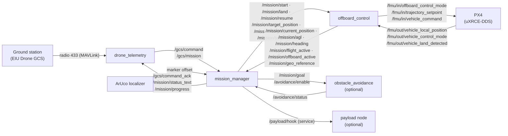
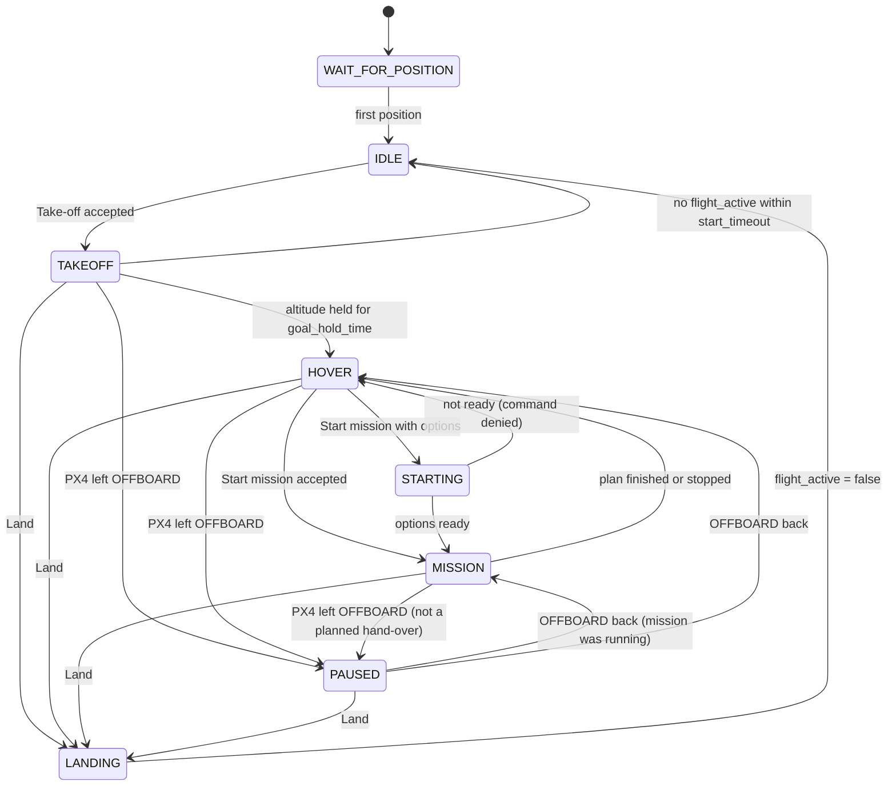
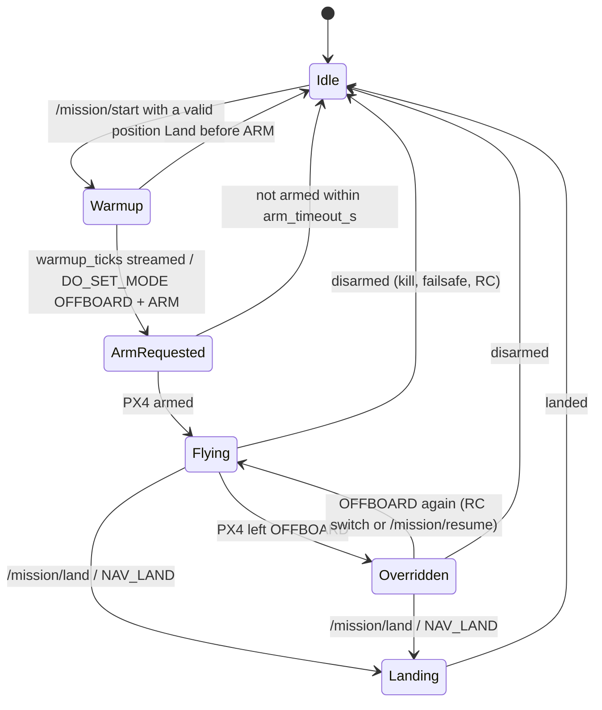

# offboard_control — Architecture

This document describes how the two Python nodes of the package, `mission_manager` and `offboard_control`, are built and how they talk to each other, to the ground station and to PX4. Usage and parameters are in the [README](../README.md). The mission pipeline (steps, plan compilation, pick tasks, manual hand-over) is described in detail in [MISSION_PIPELINE.md](MISSION_PIPELINE.md).

## 1. Place in the system



| Node | Decides | Talks to |
|---|---|---|
| `mission_manager` | what to fly: accepts or rejects commands, runs the flight state machine and the mission plan, chooses targets | `drone_telemetry`, `offboard_control`, and the optional avoidance, marker and payload nodes |
| `offboard_control` | how to fly it with PX4: setpoint stream, OFFBOARD / ARM / LAND, pilot override, end of flight | PX4 only, plus `mission_manager` |

Two rules follow from this split. `offboard_control` is the only node that publishes to PX4, and `mission_manager` is the only node that writes the target. Optional nodes (avoidance, marker localizer, payload) only provide data or perform an action when asked; they never command PX4 or the target directly.

## 2. Interfaces

### Between the two nodes

| Topic | Type | Direction | Content |
|---|---|---|---|
| `/mission/start` | `std_msgs/Bool` | MM → OC | start a flight at the current position |
| `/mission/target_position` | `geometry_msgs/Point` | MM → OC | position target in the EKF local NED frame (m) |
| `/mission/target_velocity` | `geometry_msgs/Vector3` | MM → OC | velocity target in NED (m/s), used to align over a marker |
| `/mission/target_yaw` | `std_msgs/Float32` | MM → OC | heading (rad); NaN keeps the heading at flight start |
| `/mission/land` | `std_msgs/Bool` | MM → OC | landing request |
| `/mission/resume` | `std_msgs/Bool` | MM → OC | request OFFBOARD again after the pilot took control |
| `/mission/current_position` | `geometry_msgs/Point` | OC → MM | EKF local position, published only while valid |
| `/mission/agl` | `std_msgs/Float32` | OC → MM | height above ground from the rangefinder (`dist_bottom`), NaN when invalid |
| `/mission/heading` | `std_msgs/Float32` | OC → MM | current heading (rad, NED: 0 = north, clockwise) |
| `/mission/flight_active` | `std_msgs/Bool` | OC → MM | flight in progress (latched) |
| `/mission/offboard_active` | `std_msgs/Bool` | OC → MM | PX4 is in OFFBOARD (latched) |
| `/mission/geo_reference` | `sensor_msgs/NavSatFix` | OC → MM | EKF GPS origin; `NO_FIX` without GPS (latched) |

### With the ground station (through drone_telemetry)

| Topic | Type | Direction | Content |
|---|---|---|---|
| `/gcs/command` | `std_msgs/String` | → MM | JSON `{"id", "cmd": "takeoff" \| "land" \| "mission" \| "continue" \| "settings", "alt", "options"}` |
| `/gcs/command_ack` | `std_msgs/String` | MM → | JSON `{"id", "cmd", "result": "accepted" \| "denied", "text"}` |
| `/gcs/mission` | `std_msgs/String` | → MM | JSON item list `{seq, lat, lon, alt, command, frame, params}`, altitude above Home (latched) |
| `/mission/status_text` | `std_msgs/String` | MM → | JSON `{"severity", "text"}`, sent to the ground station as STATUSTEXT (50 characters) |
| `/mission/progress` | `std_msgs/String` | MM → | JSON `{"seq", "total", "state", "step"}`, sent as MISSION_CURRENT; state is `idle`, `active`, `paused` or `complete` (latched) |

### Monitoring

| Topic | Type | Content |
|---|---|---|
| `/mission/state` | `std_msgs/String` | core state name (`HOVER`, `MISSION`, ...), every tick |
| `/mission/nav_mode` | `std_msgs/String` | navigation mode (`NOMINAL`, `AVOIDING`, `HOLDING`), every tick |

### With PX4 (offboard_control only)

| Topic | Direction | Use |
|---|---|---|
| `/fmu/in/offboard_control_mode` | → PX4 | position or velocity control; part of the OFFBOARD heartbeat |
| `/fmu/in/trajectory_setpoint` | → PX4 | position (NED) or velocity, and yaw |
| `/fmu/in/vehicle_command` | → PX4 | DO_SET_MODE OFFBOARD, ARM, NAV_LAND |
| `/fmu/out/vehicle_local_position[_vN]` | PX4 → | position, validity flags, `dist_bottom`, EKF GPS origin, heading |
| `/fmu/out/vehicle_control_mode` | PX4 → | arming state and whether OFFBOARD is active |
| `/fmu/out/vehicle_land_detected` | PX4 → | touchdown |

The `_vN` suffix is derived from `MESSAGE_VERSION` in `px4_msgs`. `vehicle_status` is not used: its version differs between firmware releases and the workspace `px4_msgs`, and with a mismatch no message arrives at all. `vehicle_control_mode` (version 0) carries both the armed flag and the OFFBOARD flag.

### With optional nodes

| Node | Interface | Used for |
|---|---|---|
| obstacle_avoidance | `/mission/goal` (Point) and `/avoidance/enable` (Bool) out, `/avoidance/status` (`custom_msgs/AvoidanceStatus`) in | missions started with the avoidance option |
| ArUco localizer | `marker_topic` (`geometry_msgs/PointStamped`, marker offset from the drone in ENU) in | Search and Align steps of pick tasks |
| payload | `payload_service` (`std_srvs/Trigger`) | automatic hook in pick tasks |

### QoS

PX4 topics use BEST_EFFORT, as uXRCE-DDS requires. `/mission/flight_active`, `/mission/offboard_active`, `/mission/geo_reference`, `/mission/progress` and `/gcs/mission` are RELIABLE + TRANSIENT_LOCAL with depth 1, so a node that starts or restarts late immediately receives the current value. The other internal topics use the default QoS (depth 10).

## 3. mission_manager

### Core state machine



Any flying state also returns to `IDLE` when `offboard_control` reports that the flight has ended (disarm, refused ARM).

The core never refers to a specific task. While in `MISSION` it hands every tick to the mission executor, which runs the compiled plan; the core only reacts to the executor's result (running, done, failed) and to commands. The pipeline is described in [MISSION_PIPELINE.md](MISSION_PIPELINE.md).

The node runs one timer at `control_rate_hz` (20 Hz). Each tick checks for a pilot override, runs the current state, and publishes the state, the navigation mode, the avoidance enable flag and the progress.

### Command handling

1. The JSON command is parsed. A command with the same `id` as the previous one is a resend after a lost ACK: the stored ACK is sent again and nothing else happens.
2. The command is checked against the state:
   - Take-off: only in `IDLE`, with a position younger than `position_timeout`, and an altitude ≤ `max_takeoff_altitude`.
   - Start mission: only in `HOVER`, if the mission compiles and every capability it needs is present (see section 6).
   - Continue: during a manual hand-over or in `PAUSED`.
   - Land: in any flying state; a running plan is aborted.
   - Settings: only while a mission is starting, running or paused. The new speed and tolerances replace the current ones from the next tick; values of 0 are left unchanged.
3. The result is published on `/gcs/command_ack`. A mission with options is answered when the options are ready (`STARTING`, at most `avoidance_ready_timeout`). Whether PX4 actually entered OFFBOARD or armed is checked by `drone_telemetry`, which waits for the PX4 acknowledgements before reporting `ACCEPTED` to the ground station.

### Altitudes and speed

Take-off climbs vertically from the current position: `target.z = z_now - alt`. The ground z at that moment is stored as Home and is the reference for waypoint altitudes (`z = z_ground - alt`).

While flying to a waypoint the nose points at it (`yaw_mode: waypoint`), turning at most `yaw_rate_deg`; at the start of every leg, a heading error above `turn_first_deg` (10°) makes the drone turn in place before it moves. HOVER after a mission keeps the current heading. Details in [MISSION_PIPELINE.md](MISSION_PIPELINE.md).

Without avoidance, legs between waypoints are flown at the mission speed (`cruise_speed` unless the ground station sets one, also during the mission): the target is a carrot that moves along the leg at that speed and waits when the drone lags behind, so PX4 never receives a far-away setpoint. PX4's own limits (`MPC_XY_VEL_MAX`, `MPC_Z_VEL_MAX_UP/DN`) remain the hard ceiling, and they also apply to take-off and vertical moves.

### Keep distance while hovering

With `hover_keep_distance > 0` (and `allow_avoidance`, with the avoidance node running), HOVER also enables the avoidance node and sends the hover point as its goal. When the reported `min_distance` is below `hover_keep_distance`, the hover point moves straight away from the nearest obstacle (`min_distance_bearing + 180°`) at `hover_retreat_speed`, at most `hover_max_drift` from where HOVER began. The drone stays where it ends up and does not return when the obstacle leaves. A stale or STALE status keeps the hover point. Only the nearest obstacle is known, so an obstacle behind the drone is not checked; the drift limit bounds the risk.

## 4. offboard_control

### Flight lifecycle



These states are implicit in the code (`flight_active`, `offboard_seen`, `offboard_active`, `arm_request_time`, `was_armed`, `land_command_sent`); leaving a flight always goes through `end_flight()`, which resets them and publishes `/mission/flight_active = false`.

### Setpoint stream

A timer at `setpoint_rate_hz` (10 Hz) publishes `OffboardControlMode` and `TrajectorySetpoint` for as long as a flight is active. PX4 accepts OFFBOARD only after it has seen this stream, which is why the first `offboard_warmup_s` only streams. During the flight the stream is the OFFBOARD heartbeat: if the node hangs or loses DDS, PX4 leaves OFFBOARD and runs its failsafe.

The setpoint is either a position or a velocity, whichever `mission_manager` sent last. `mission_manager` repeats the target on every tick; a changed target is sent to PX4 at once, an unchanged one only with the timer stream. Velocity setpoints must be refreshed within `velocity_timeout_s`; otherwise the node switches back to holding the current position.

### Pilot override

`vehicle_control_mode.flag_control_offboard_enabled` tells the node whether PX4 is in OFFBOARD; changes are published on `/mission/offboard_active`. When PX4 leaves OFFBOARD after having reached it (sticks moved with `COM_RC_OVERRIDE`, RC mode switch, GCS Hold or RTL), the node keeps streaming but ignores targets and makes the setpoint follow the current position. When OFFBOARD comes back, either because the pilot flips the RC switch to Offboard or because `/mission/resume` makes the node send DO_SET_MODE OFFBOARD, the drone continues from where the pilot left it instead of jumping back to an old target.

### Position forwarding

`vehicle_local_position` is forwarded as `/mission/current_position` only while `xy_valid` and `z_valid` are true, and `dist_bottom` as `/mission/agl` (NaN unless `dist_bottom_valid`). The EKF GPS origin is published on `/mission/geo_reference` whenever it or its validity changes.

## 5. Sequences

### Take-off

```
GCS           drone_telemetry     mission_manager            offboard_control             PX4
 │ Take-off 5 m ──►│                     │                          │                       │
 │                 │ /gcs/command ──────►│ IDLE -> TAKEOFF          │                       │
 │                 │◄─ /gcs/command_ack ─│ (accepted)               │                       │
 │                 │                     │ /mission/start ─────────►│ hold point = here     │
 │                 │                     │ /mission/target_position►│ stream setpoints (1 s)│
 │                 │                     │◄── /mission/flight_active│                       │
 │                 │                     │                          │ DO_SET_MODE OFFBOARD ─►│
 │                 │                     │                          │ ARM ─────────────────►│
 │◄─ ACCEPTED ─────│ (after PX4 ACKs OFFBOARD + ARM)                │                       │
 │                 │                     │ target reached -> HOVER  │                       │
```

### Pilot override and resume

```
pilot / GCS              offboard_control                 mission_manager
 │ sticks moved ────────► PX4 leaves OFFBOARD             │
 │                        /mission/offboard_active=false ►│ MISSION -> PAUSED, plan paused
 │                        setpoint follows the drone      │ STATUSTEXT "Paused: pilot in control"
 │ Continue (GCS) ───────────────────────────────────────►│ /mission/resume
 │                        DO_SET_MODE OFFBOARD ─► PX4     │
 │   or RC switch to Offboard                             │
 │                        /mission/offboard_active=true ─►│ PAUSED -> MISSION, step restarted here
```

### Land and end of flight

```
mission_manager                 offboard_control                      PX4
 │ /mission/land ──────────────►│ NAV_LAND ──────────────────────────►│
 │ state LANDING                │                 vehicle_land_detected│ landed
 │◄── /mission/flight_active=false (end_flight)                       │
 │ LANDING -> IDLE              │                                      │
```

The mission and pick-task sequences are in [MISSION_PIPELINE.md](MISSION_PIPELINE.md).

## 6. Failure handling

| Situation | Behaviour |
|---|---|
| EKF position invalid or not published | Take-off rejected (`position_timeout`) |
| `offboard_control` not running | Take-off cancelled after `start_timeout`, back to `IDLE` |
| PX4 refuses to arm (pre-arm check, RC, kill) | flight cancelled after `arm_timeout_s` |
| Land pressed before ARM | flight cancelled without arming |
| `offboard_control` stops during flight | PX4 loses the setpoint stream, leaves OFFBOARD and runs its failsafe |
| Pilot takes over (outside a planned hand-over) | `PAUSED`; Continue or an RC switch back to Offboard resumes from the current position |
| No GPS origin (indoors) | Take-off, Hover and Land work; Start mission is rejected |
| Option or task needs a missing node | Start mission rejected with the reason; the drone keeps hovering |
| A step fails (marker not found, payload error, timeout) | fallback to a manual hand-over where defined, otherwise the plan stops and the drone hovers |
| Avoidance data stale or path blocked | HOLDING, then `blocked_action` after `blocked_timeout` |
| ACK lost on the radio | the resent command only repeats the stored ACK |

## 7. Threading

Each node is a single-threaded `rclpy` node. Timers and subscriptions run on one executor thread, so state is never shared between threads and no locks are needed. The payload request is an asynchronous service call polled from the timer, so waiting for the gripper never blocks the node. Timing decisions use the node clock in seconds rather than tick counts, so changing a rate parameter does not change behaviour.
