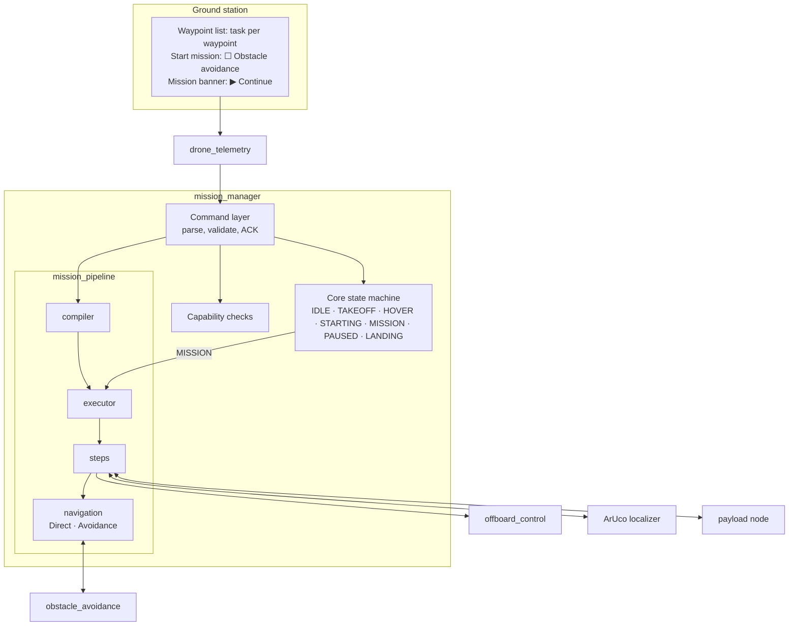
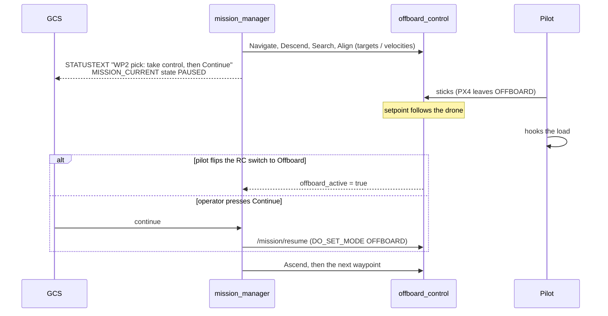

# Mission pipeline

How a mission is turned into steps and run: plan compilation, the steps, navigation strategies, tasks at waypoints (pick with ArUco alignment, automatic or manual hook), the planned hand-over to the pilot, and the options chosen at mission start. The code is in `px4_offboard/mission_pipeline/` (pure Python, no ROS) and is driven by `mission_manager.py`. The rest of the package is described in [ARCHITECTURE.md](ARCHITECTURE.md).

## 1. Principles

1. **Fixed core.** Take-off, hover, Land, RTL and Hold are always available and do not depend on any optional feature.
2. **Default stays simple.** With no task and no option, the drone takes off, hovers, flies the waypoints and holds position at the last one, waiting for Land or RTL.
3. **Options are fixed at mission start.** They are read when Start mission is accepted and do not change during that mission. Only the speed and the arrival tolerances can be changed while the mission runs (section 10).
4. **Refuse rather than degrade.** If a selected feature is not available or not ready, Start mission is rejected with a reason and the drone keeps hovering.
5. **Ground station commands preempt.** Land, RTL and Hold interrupt whatever step is running.
6. **One writer per output.** `mission_manager` is the only writer of the target; `offboard_control` is the only node that commands PX4.
7. **Pure-Python core.** Compiler, executor, steps and navigation have no ROS dependency and are tested with a simulated vehicle.
8. **Single thread.** Long operations (gripper) run in other nodes and are called asynchronously.

## 2. Layers



| Module | Content |
|---|---|
| `compiler.py` | mission items + options → plan of steps; lat/lon → local NED; validation |
| `executor.py` | `MissionExecutor`: runs the plan, applies fallbacks, pause / resume / abort |
| `steps.py` | `Navigate`, `HoldTime`, `Descend`, `Search`, `Align`, `PayloadHook`, `ManualHandover`, `Ascend`, and `StepConfig` |
| `navigation.py` | `DirectNav` (speed-limited carrot) and `AvoidanceNav` (obstacle_avoidance setpoints with hold logic) |
| `mission_manager.py` | ROS node: core state machine, command layer, capability checks, and `MissionContext`, the bridge between the steps and ROS |

## 3. Mission items

The ground station uploads one MAVLink mission item per waypoint (frame `GLOBAL_RELATIVE_ALT_INT`, altitude above Home). `drone_telemetry` stores them on `/gcs/mission` as JSON with their command and `param1..4`.

| Command | Meaning | Params |
|---|---|---|
| `NAV_WAYPOINT` (16) | fly through | — |
| `NAV_LOITER_TIME` (19) | fly there and hold | p1 = seconds |
| `MAV_CMD_USER_3` (31012), project convention "PICK" | fly there and pick up a load | p1 = 0 automatic hook, 1 manual hook; p2 = search height (m above ground); p3 = hook height (m above ground) |

Any other command, frame or out-of-range value rejects the whole mission. Pick heights must satisfy `0.5 m ≤ hook ≤ search ≤ waypoint altitude`.

## 4. Plan compilation

At Start mission the items are compiled once into a flat list of steps. Each item becomes a `Navigate` step followed by the steps of its task:

| Item | Steps |
|---|---|
| fly through | `Navigate` |
| loiter | `Navigate`, `HoldTime(p1)` |
| pick, automatic hook | `Navigate`, `Descend(search)`, `Search`, `Align(hook)`, `PayloadHook`, `Ascend(waypoint altitude)` |
| pick, manual hook | `Navigate`, `Descend(search)`, `Search`, `Align(hook)`, `ManualHandover`, `Ascend(waypoint altitude)` |

`Search`, `Align` and `PayloadHook` have a `ManualHandover` fallback. When one of them fails, the pilot is asked to take over, and when the pilot is done the remaining pick steps are skipped and the plan continues with `Ascend`. A failure without a fallback stops the plan and the drone hovers where it is.

The compiler also returns the capabilities the plan needs: `avoidance` (option), `rangefinder` and `marker` (any pick), `payload` (automatic pick).

## 5. Steps

Every step has `start`, `tick` and `abort`, and talks to the vehicle only through the context object (`ctx`). `tick` returns running, succeeded, or failed with a reason.

| Step | Does | Succeeds when | Fails when |
|---|---|---|---|
| `Navigate` | flies to the waypoint with the navigation strategy | inside `xy_tolerance` / `z_tolerance` for `goal_hold_time` | avoidance `blocked_action: land` |
| `HoldTime` | holds position | the time has elapsed | — |
| `Descend` | moves vertically to a height above ground, using the rangefinder | within `agl_tolerance` for `goal_hold_time` | no rangefinder for `agl_lost_timeout`, or `descend_timeout` |
| `Search` | holds position, waits for the marker | marker seen continuously for `marker_seen_time` | `search_timeout` |
| `Align` | centres over the marker with velocity setpoints, descending to the hook height once roughly centred | offset < `align_tolerance` and height within `agl_tolerance` for `goal_hold_time` | marker lost for `marker_lost_timeout`, or `align_timeout` |
| `PayloadHook` | holds position, calls the payload service | the service reports success | service missing, failure, or `payload_timeout` |
| `ManualHandover` | holds position and asks the pilot to take over | the pilot switches back to Offboard, or the operator presses Continue | — (waits; reminders every `manual_reminder`) |
| `Ascend` | climbs vertically back to the waypoint altitude | within `z_tolerance` for `goal_hold_time` | no position |

All thresholds are fields of `StepConfig` (`steps.py`). The arrival tolerances (`xy_tolerance`, `z_tolerance`) come from the ground station with Start mission (*Arrival tolerance* in the waypoint list), can be changed while the mission runs, and apply to every waypoint; without them the node parameters are used. Values are clamped to 0.2–5 m (xy) and 0.1–3 m (z), and the ACK reports the values in use. Take-off keeps the node defaults.

### Align control

The marker offset from the drone (north, east) gives the horizontal velocity: `v = align_gain × offset`, limited to `align_max_speed`. Once the offset is below twice `align_tolerance`, the vertical velocity brings the height above ground to the hook height: `vd = align_vz_gain × (agl − hook)`, limited to `align_max_vz`. If the marker is lost, the drone holds its position until it reappears or `marker_lost_timeout` expires.

## 6. Options and capabilities

Options are sent with Start mission. Today there is one: obstacle avoidance, which makes every `Navigate` step use `AvoidanceNav`.

Before a mission starts, `mission_manager` checks every capability the plan needs:

| Capability | Check | Refused with |
|---|---|---|
| `avoidance` | parameter `allow_avoidance` is true and a node subscribes to `/avoidance/enable`; then the node is enabled and must publish a CLEAR or AVOIDING status within `avoidance_ready_timeout` (state `STARTING`, the drone keeps hovering) | "avoidance disabled on the drone", "avoidance node not running", "avoidance not ready" |
| `rangefinder` | `/mission/agl` is valid now | "pick needs a rangefinder" |
| `marker` | a node publishes on `marker_topic` | "pick needs the marker localizer" |
| `payload` | the `payload_service` server is available | "automatic pick needs the payload node (use manual)" |

`allow_avoidance` is false by default, so missions with avoidance are refused until the avoidance node has been tested and the parameter is switched on. When the avoidance node is later finished, it only has to follow its contract (`/mission/goal`, `/avoidance/enable`, `/avoidance/status`) to be picked up without changes to `mission_manager`.

## 7. Planned hand-over versus pilot override

There are two ways the pilot ends up flying during a mission, and the system treats them differently.

| | Planned hand-over | Pilot override |
|---|---|---|
| Trigger | the plan reaches `ManualHandover` (manual hook, or fallback after a failed step) | PX4 leaves OFFBOARD while no hand-over is running (sticks moved, mode switch, GCS Hold or RTL) |
| Core state | stays `MISSION`; progress reported as `paused` | `PAUSED`; the plan is paused |
| Ground station | "WPn pick: take control, then Continue" + Continue button | "Paused: pilot in control. Continue to resume" + Continue button |
| Done when | the pilot switches back to Offboard, or Continue is pressed | the pilot switches back to Offboard, or Continue is pressed |
| Afterwards | the plan continues with the next step (`Ascend`) | the interrupted step restarts from where the drone is now |

In both cases `offboard_control` keeps streaming while the pilot flies, with the setpoint following the drone, so returning to OFFBOARD does not move it. Continue sent while PX4 is not in OFFBOARD makes `offboard_control` request OFFBOARD again.

### Manual pick sequence



## 8. Heading

With `yaw_mode: waypoint` (default), `Navigate` points the nose at the waypoint, so the camera and the lidar face the direction of travel:

1. At the start of every leg the heading is checked. If the error is larger than `turn_first_deg` (10°), the drone holds its position and turns first; it starts moving once the error is below half of that (5°). If the heading cannot be reached within 10 s (e.g. a compass problem), it moves on and logs a warning.
2. During the leg the heading follows the bearing to the waypoint, turning at most `yaw_rate_deg` (45°/s).
3. Within `yaw_freeze_radius` (1.5 m) of the waypoint the heading is kept, because the bearing becomes unstable close to the point.

Task steps (Descend, Search, Align, Hook, Ascend) keep the heading of the arrival, and HOVER after the mission keeps the current heading instead of turning back to the take-off heading. A pilot override also keeps the pilot's heading when OFFBOARD returns. `yaw_mode: hold` keeps the take-off heading for the whole mission; a finite `mission_yaw` sets a fixed heading.

## 9. Speed

The speed between waypoints is set on the ground station (*Mission speed* in the waypoint list) and sent with Start mission; it applies to every leg. A change on the ground station during the mission takes effect on the current leg. Without a speed from the ground station, `cruise_speed` (2 m/s) is used, and any speed above `max_cruise_speed` (5 m/s) is reduced to it (the ACK says "limited").

Without avoidance, `DirectNav` limits the speed between waypoints to that mission speed. It moves a carrot from the start of the leg towards the waypoint at that speed and keeps it at most `max_lead` (3 m) ahead of the drone. PX4's limits stay in force as the hard ceiling and should be set to match:

| PX4 parameter | Role |
|---|---|
| `MPC_XY_VEL_MAX` | maximum horizontal speed in any position-controlled mode, including OFFBOARD |
| `MPC_Z_VEL_MAX_UP`, `MPC_Z_VEL_MAX_DN` | maximum climb and descent speed (take-off, Descend, Ascend) |
| `MPC_ACC_HOR`, `MPC_JERK_AUTO` | acceleration and jerk, for smoother starts and stops |

With avoidance, the avoidance node sets the speed itself through its carrot and its stopping-distance limit.

## 10. Ground station protocol

| Item | Transport |
|---|---|
| Waypoints and tasks | MAVLink mission protocol; `command` and `param1..4` per item (section 3) |
| Start mission + options | `COMMAND_LONG MAV_CMD_MISSION_START`, `param3` = option bitmask (bit 0 = obstacle avoidance), `param4` = speed between waypoints (m/s), `param5` / `param6` = arrival tolerance xy / z (m); 0 = default |
| Continue | `COMMAND_LONG MAV_CMD_DO_PAUSE_CONTINUE`, `param1 = 1` |
| Live settings | `COMMAND_LONG MAV_CMD_USER_2` (31011), `param1` = speed (m/s), `param2` / `param3` = arrival tolerance xy / z (m); 0 = unchanged. Applied to the running or paused mission from the next setpoint; refused when no mission runs |
| Progress | `MISSION_CURRENT` (seq, total, mission_state: NOT_STARTED / ACTIVE / PAUSED / COMPLETE) once per second and on change |
| Messages | `STATUSTEXT` from `/mission/status_text` |

## 11. Testing

```bash
cd ~/drone_ws/src/offboard_control
python3 -m pytest test/test_mission_pipeline.py          # no ROS needed
source /opt/ros/humble/setup.bash && source ~/drone_ws/install/setup.bash
python3 -m pytest test/test_mission_manager_node.py      # real node, simulated vehicle, isolated DDS domain
python3 -m pytest test/test_offboard_control_node.py     # warmup, OFFBOARD + ARM, arm timeout, disarm
```

The tests cover the default mission, loiter, automatic and manual picks, the fallback to manual when the marker is not found, the Continue button, pilot override and resume, capability refusals, Land during a mission, the speed limit, the arrival tolerances, and settings changed during a mission.

Before flying a pick on the real drone, test in SITL in this order, with the propellers removed for the first ground tests: hover → mission without tasks → manual pick without a marker (the fallback hand-over) → manual pick with the marker → automatic pick with a payload node stub. Check `COM_RC_OVERRIDE` (offboard bit set) and an RC switch position for Offboard in QGC.

## 12. Open points

- The ArUco localizer (`aruco_detection/marker_localizer_node.py`) still reads its attitude from MAVROS topics; for this pipeline it must use PX4 attitude over DDS and publish `marker_rel` in the same local frame.
- There is no payload node yet; any `std_srvs/Trigger` server on `payload_service` that returns once the load is hooked will do.
- What to do with a held load when Land or RTL interrupts a pick is not defined yet.
- RTL and Hold from the ground station still go directly to PX4; `mission_manager` sees them as a pilot override (`PAUSED`).
